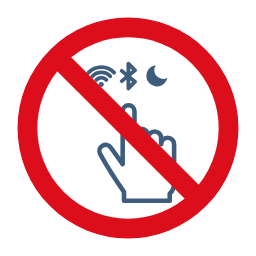

# The NoLockQS Project 🔐🚫

**Prevents access to the Quick Settings / Control Center tiles and the power menu on the lock screen of rooted Pixels and near-stock Android phones.**

Built on the modern Xposed API (libxposed 101+); Not tied to a specific Pixel model or Android release.

## ✨ Features
- 🧱 **Quick Settings locked away** while the phone is locked: no tiles, no toggles, while notifications still open and expand
- ⏻ **Power menu blocked** on the lock screen, so a locked phone can't be switched off from it
- 🔔 **Blocked-attempt alerts** after you unlock, plus a history of every attempt in the app, with a button to clear it
- 🩺 **Diagnostics report** in one tap, to share when something isn't right
- 🌍 English, العربية and 简体中文

## Requirements:
- Rooted phone running Android 15 or newer (tested on Android 15-17): a Pixel, or a ROM with near-stock (AOSP) System UI 🤖
- Vector 2.2 (Minimum) 🚀

> **Android 17:** use Magisk 31.0+ and a Vector canary (3112 or newer). Magisk 30.7 and Vector 2.2 stable don't load modules on Android 17.

## 🚀 Installation

1. Download the APK from the [latest release](https://github.com/Xposed-Modules-Repo/io.github.i2B4G10.NoLockQS/releases/latest) and install it on your rooted device.
2. Open Vector, enable the module, and check the scope it asks for (System UI and System Framework).
3. Reboot, and the protection is active! If the app says **Scope incomplete**, tap the card to add what's missing.

## 📜 License

© 2026 Faisal AlDossary. All rights reserved.

NoLockQS is proprietary software: you may install and use it on your own devices, but you may not redistribute, modify or repackage it. See the [license](LICENSE) for the full terms.

### ❤️ You can show your love on [Patreon](https://www.patreon.com/c/Dossary) or [Ko-fi](https://ko-fi.com/Q8G429G7HX)!

**Made in Saudi 🇸🇦**

